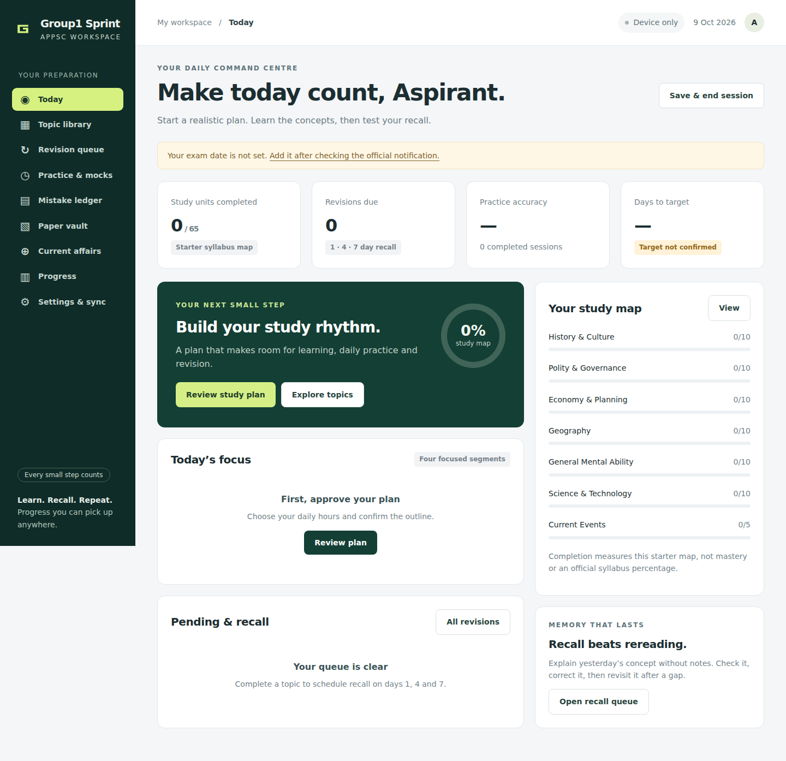

# Group1 Sprint

An offline-first APPSC study workspace for Android and desktop. A responsive forest-green interface keeps the next learning action visible, without fabricated scores or progress. Personal study records live on the device and can sync, encrypted, into a separate **private** GitHub repository.



## What works in v1

- Today dashboard, provisional plan approval and unfinished-topic carryover.
- A 65-unit starter map with search and subject filters. This is **not** a certified complete official syllabus.
- Guided Fundamental Rights starter lesson, plus original offline foundation guides and recall prompts for all 65 units; save deeper lessons to each topic.
- Saved lesson position; persistent 1/4/7 revision queue and mistake ledger.
- Five-question/six-minute original GMA drill; timed 30-question tests and 120-question paper mocks when enough imported questions exist.
- JSON/CSV question import with provenance requirements for user-supplied PYQs. No invented years or paper claims.
- Score = correct − wrong/3; skipped questions score zero. Track confidence and eliminated options.
- PDF/PNG/JPEG reference vault (4 MB per file), local PDF text extraction, editable question drafts with unknown answers, and a current-affairs journal.
- Full JSON backup/merge including attachments. Credentials excluded.
- Offline app-shell cache, IndexedDB event persistence and encrypted cross-device event sync that preserves unsaved editors.
- Study Tutor with external chat/signup links and optional direct API adapters for OpenAI, Claude, DeepSeek and xAI.
- Optional private service for PIB release collection, official APPSC PDF fetching, scanned-PDF OCR and Web Push reminders; calendar reminders work independently.

## Run locally

Requires Node 22.13+ (or current Node 24) and Python 3 for local serving. PDF.js assets are built locally and cached for offline use.

```sh
npm ci
npm run build
npm test
npm start
```

Open `http://localhost:8080`. Serve via HTTPS for a phone installation; the localhost exception only applies on the same machine. Opening `index.html` directly from disk is not the supported PWA path. Local URLs on a laptop are not automatically accessible from Android.

## Publish to GitHub Pages

1. Repository Settings → Pages → Source → **GitHub Actions**.
2. Actions → **Publish study workspace** → **Run workflow** on `main`.
3. Use the URL reported by the deployment; open it in Chrome on Android and install/add to home screen.

The Pages workflow publishes **only `app/`**, never personal vault files. The deployment requires the one-time Pages setting; this repo's connector cannot change that administration setting. Hosting is not claimed live until a deployment succeeds. Subsequent deployments are manually triggered so unreviewed changes do not silently replace an installed app.

## Connect Android and laptop

In Settings & sync, enter the same private data repo (`imranshaik-pro/crack-group1-data`), a fine-grained GitHub token restricted to that repo with Contents read/write, and the same vault passphrase (12+ characters) on each device. **Never send credentials in chat or commit them.** Token/passphrase are memory-only and must be re-entered after a page reload. This is deliberately a personal-use v1; OAuth through a backend is the recommended public-product upgrade.

Unlocking first pulls existing remote records, then uploads local pending events. It refuses public data repositories. Saves are debounced while unlocked; reconnect, focus, resume and a 30-second interval trigger sync. Network failures back off without blocking study. Remote updates preserve unsaved forms. The header shows a small sync indicator; manual retry is under Settings & sync. Use **Save & end session** and wait for **All changes synced** before switching. Closing a mobile app is not a reliable upload trigger. Offline changes remain pending on the original device until it reconnects and syncs.

GitHub is a small personal vault, not a real-time multi-user database. Concurrent offline edits to the same note resolve deterministically; both edits remain in the event history. Remote batches are immutable and deduplicated. See [architecture](docs/ARCHITECTURE.md).

## Question import

JSON: array of `{id,text,options:[A,B,C,D],answer,topic,kind,paper,explanation}`. Answer is zero-based 0–3. `kind` is `original`, `practice` or `PYQ`. A PYQ additionally requires numeric `year`, HTTPS `source`, `paper`, and `questionNumber`. A source URL is a provenance record, not independent verification. Check against the actual official paper/key before trusting imported answers.

CSV header:

```csv
id,text,A,B,C,D,answer,topic,kind,year,source,paper,questionNumber,explanation
```

Quote cells containing commas, quotes or newlines. Use topic IDs from `app/content.js`; e.g. `t-1-1` = Fundamental Rights. Full mocks need at least 120 reviewed, eligible questions with the selected paper (`I` or `II`); weekly tests need 30 reviewed, eligible questions. Bundled questions are original exercises, not previous-year questions.

## Accuracy and limits

Exam schedule, notification number, vacancy count, pattern and negative-marking rules need verification against the official APPSC notification. No unconfirmed exam date is seeded. The Telugu subject labels are descriptive; they are not represented as official APPSC translations. Every topic has a short original orientation, not a complete verified chapter. Extracted questions and AI explanations require review. Direct AI, OCR, news fetching and closed-app push need the optional running private service; they are not hosted by GitHub Pages. PIB is a starter feed, not complete AP/international coverage. A full Telugu interface is still pending.

Local storage and exported backups are readable personal data; remote vault batches use AES-256-GCM, random salts/IVs and PBKDF2-SHA256 (310,000 iterations). Losing the passphrase prevents remote decryption. Browser data can be cleared or evicted: export backups regularly. Private GitHub storage and encryption do not make a shared unlocked device private.

## Project record

- [Architecture & security](docs/ARCHITECTURE.md)
- [Product decisions & next priorities](docs/DECISIONS.md)
- [Build and validation record](docs/BUILD_LOG.md)

Core checks and a desktop/mobile browser workflow cover offline reload, question review, PDF extraction and saved lessons. See the build record for actual validation results. The restricted local build environment could not install or launch Chromium; GitHub runners completed browser verification and upload screenshots. No claim of live end-to-end GitHub-token sync is made without a real device setup.

## Reviewed material imports

Practice now includes a **content quality desk**. JSON/CSV imports enter review rather than immediately entering timed tests. Check the topic, answer and sources, record the check, then approve or exclude. PYQs additionally require APPSC-hosted paper and answer-key URLs; the app records your review and does not authenticate PDFs. Unmapped questions stay unassigned.

See [material integration and usefulness assessment](docs/MATERIAL_INTEGRATION.md) for conversion commands, source limitations and counts. Third-party banks are supplied separately for personal imports and are not bundled in the public Pages deployment.

## Connected features

See [setup and end-to-end usage](docs/CONNECTED_FEATURES.md) for the private service, provider credentials, extraction/review workflow and Android notifications. No provider keys or service credentials are committed. Chat/signup links work without that service; direct replies require supported provider access and may incur API charges. Registered Sign in with ChatGPT is a separate integration, not activated in this build.
