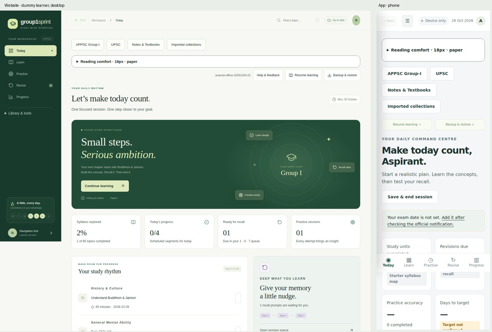
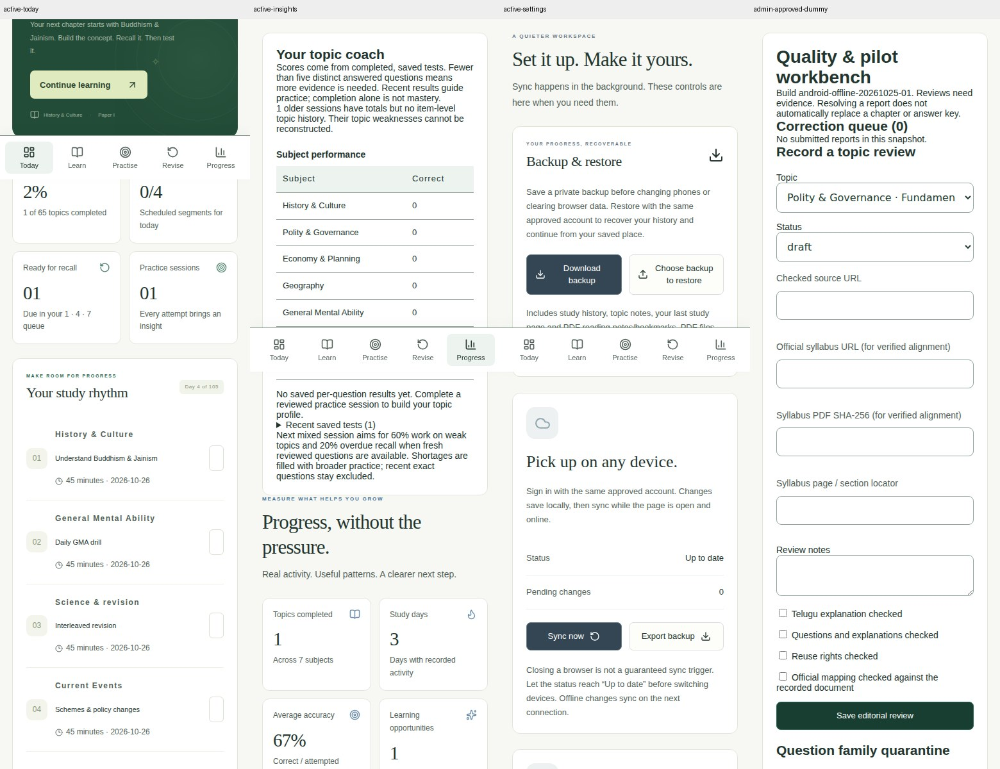
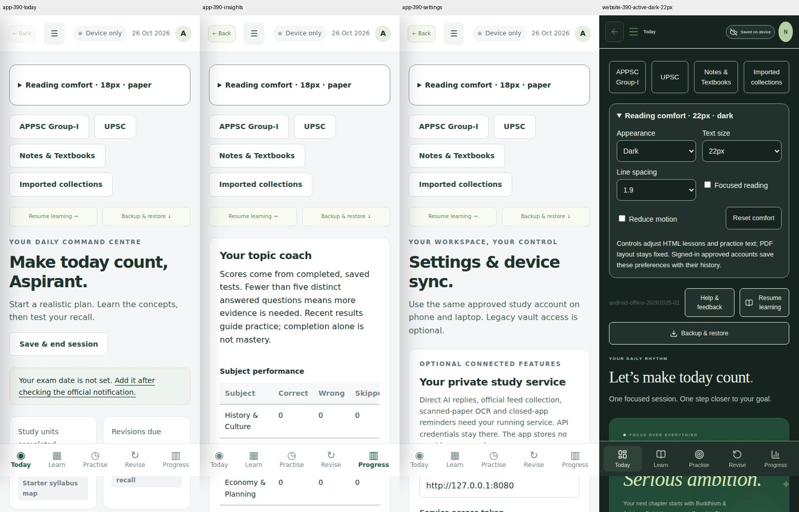

# Dashboard dummy-user QA — 26 October 2026

## Scope and identities

This audit uses isolated synthetic guest, pending learner, approved learner and superadmin sessions. All account/workspace/product transports in browser tests are mocked; dummy email addresses use example.test. No real learner record, membership, invitation, credential or production account was created or changed. Passing this audit does not certify a live ChatGPT sign-in or physical-phone acceptance.

## Repairs

| Finding | Correction |
| --- | --- |
| Guest and pending users were told “Session saved. You can pick up on another device.” with an empty queue | The end-session control now checks confirmed saving access and displays sign-in/approval guidance. |
| A learner without a plan saw 0/4 daily progress despite no scheduled tasks | The empty card now shows an em dash and asks the learner to approve a plan. Scheduled plans use the real daily task count. |
| The hero always labelled the next topic as Paper I | The label uses the selected topic’s paper. |
| Mixed practice appeared as “Polity practice” in history | Recent practice distinguishes GMA, personalised and Fundamental Rights sessions. |
| Small, faint statistics, task metadata and account labels were difficult to read | Dashboard labels use reading colour tokens and larger text; recall and statistic cards respect paper, sepia and dark appearances. |
| Expanded tools could exceed the phone drawer height | The sidebar scrolls independently, keeping the lower tools reachable. |
| Selecting the current page left the phone drawer open | Navigation closes the drawer before deciding whether a route change is needed. The regression waits for the scrim to detach. |
| Phone shortcuts and bottom-navigation labels were tiny; dark mode retained bright shortcut backgrounds | Larger labels, adequate control height and theme-aware surfaces improve visibility. |

Manual review of the first passing 175-screen artifact then identified additional faint settings/backup copy, small tracker table text and small action labels. PR #9 applies reading tokens, 13px copy/labels and 44px action controls, followed by the same full regression matrix.

## Test matrix

Website routes: Today, Learn, Practise, Revise, Progress, Notes & Textbooks, Learning coverage, UPSC resources, Imported collections, Study plan, Paper vault, Reading room, Current affairs, AI study companion, Help & feedback, Settings, Control room, Account and Recovery. Approved learner and superadmin views are checked at 320, 390 and 1440 px.

Additional checks cover empty guest/pending/approved dashboards, all three appearances at 22px, a dummy membership approval, and mobile drawer navigation. The browser-backed Android/PWA audit covers its 16 sidebar destinations plus Study plan and a chapter route at the same three widths. Tests assert that the navigation actually rendered before collecting routes.

Each completed screen receives a screenshot and page geometry check. The report records page-level horizontal overflow and JavaScript errors. Statistics text receives computed contrast checks in all three appearances. This is a targeted readability check, not a claim of a complete WCAG audit or a pixel-by-pixel review of every screen. Wide data tables and enlarged PDF pages can scroll inside their own containers; the overflow check concerns the page itself.

## Evidence

The initial run, https://github.com/imranshaik-pro/group1-sprint/actions/runs/40343090256, captured 117 website views. It found no page-level horizontal overflow or page errors, and correctly failed on the two false save confirmations. Its artifact is 12660749265. The initial app route collection could race with IndexedDB startup; it was corrected to wait for navigation and require a nonempty route list. The initial report must not be used as proof of app coverage.

Browser test harness repairs also ensure that failures close Chromium and preserve partial results, and that appearance controls stay expanded across same-document navigation. These repairs retain the assertions rather than skipping a failing check.

Manual Chrome review used a development-only iframe at 390px and 1100px with the real Workspace component and mocked in-memory transports. Verified plan approval, four dated tasks, a task changing daily progress from 0/4 to 1/4, pending-user feedback, the expanded navigation, and dark appearance at 22px. The HTTP preview needed test-only IDs because crypto.randomUUID is unavailable on that preview origin; no application crypto or authentication code was changed. The preview fixture and its public/build files were removed before release packaging.

All 53 typed website tests passed locally, including membership boundaries, backup identity checks, event validation and reading contrast. The production Vinext build passed. Build tooling still warns about chunks over 500 kB; loading performance remains a follow-up, not a failed functional check.

## Final results and publication receipt

Both the functional repair and the final visual polish passed the complete audit.

| Evidence | Result |
| --- | --- |
| PR #8 | Merged as d3bb0b2b6ee08a66e7287ad37ae8025683fbc127 |
| First complete passing audit | https://github.com/imranshaik-pro/group1-sprint/actions/runs/40366543026 — 175 screens, zero findings; artifact 12670827784 |
| PR #9, final readability follow-up | https://github.com/imranshaik-pro/group1-sprint/pull/9 — merged as b6f53e1014eb9d168a463d821ab1199d920dc616 |
| Final tested source | ce5513fb29a037ac056a6b77ebcae00e40d94702 |
| Final blocking CI | https://github.com/imranshaik-pro/group1-sprint/actions/runs/40367927854 — success |
| Final dashboard evidence | Artifact 12671102535 (`dashboard-qa`), 175 screenshots, zero recorded findings |
| Matrix totals | 114 website learner/admin route views + 3 empty states + 3 appearance checks + 1 approval result + 54 app route views = 175 |
| Other checks | App build/unit checks, 53 typed website checks, all-topic clicks/chapter navigation, account isolation, feedback, offline document packs and existing browser journeys passed |
| Hosted source SHA | 3ce6dce24b657ecaa368752ffb29910a47ce33bb |
| Published Site | Version 33 — https://group1-sprint-studio.spryplume16.chatgpt.site/ |
| Saved version ID | appgprj_6acb5ae49004819180c2a6d75b1e6d6a~appgver_35abf629511881918984bb2687519836 |
| Deployment | appgdep_6adf8d35badc8191af0abc9255577a44 — succeeded, 26 October 2026 at 22:56 IST |
| Build archive | SHA-256 b66a2d7b134a25485136a4438b96335827133236fb1890b8b2b3827b7791a22e; 146,053,120 bytes; 1,001 files |

Version 31 was saved but not published while the additional drawer repair was checked. Version 32 published the functional fixes; version 33 adds the final screenshot-led readability improvements. Existing custom hosting access was preserved. A post-deployment browser visit reached the expected ChatGPT sign-in gate; this is not evidence of a real authenticated learner session.

Post-build screenshot review rechecked the desktop dashboard, phone Today/Progress/Settings, dummy admin review, app Today/Progress/Settings and 22px dark appearance. The final selected screenshots show the corrected copy and control sizes.

CI now verifies that Chromium can actually launch before falling back to OS dependency installation. All browser assertions remain enabled. No dummy preview files are in the published source or build. The shared diagnostic BUILD_ID remains `android-offline-20261025-01`; distinguish this website release using Site version 33 and the source SHA above.

The app's browser dashboards were checked; no native Android code changed and no new APK is required for these website presentation repairs.

## Retained screenshots and machine-readable results

[Full screen geometry/results](dashboard-qa/results.json) are retained in the repository. The CI artifact retains every original screenshot. These selected JPEGs are labelled crops/composites for review, not replacements for the originals. Fixed bottom navigation appears at the captured viewport boundary within full-page screenshots.

## Reproduce

The required GitHub workflow is `.github/workflows/ci.yml`. It builds the app and website fixture, runs unit/typed checks and the existing real topic-click, backup, account-isolation, feedback, offline document and reading journeys, then runs `node tests/dashboard-visual-browser.cjs`. The `dashboard-qa` artifact includes `dashboards/results.json` and the screenshots. The fixture renders production components with synthetic account data; it is not a separate dashboard implementation.

## Remaining limits

- Live provider sign-in, Site sharing and real-account sync still need acceptance with a consenting test identity. Mocked UI role checks do not prove deployed backend authorisation.
- The Android pilot’s native launcher and signing/fullscreen/Play gates remain as documented in ANDROID_PHASE3_2026-10-26.md. This phase changes website presentation and tests the PWA; it does not claim a new signed APK or new native-device test.
- Content accuracy, official syllabus mapping, Telugu/answer review, weak OCR and rights-held documents are not certified by a dashboard visual audit.
- No AI provider was activated and no live AI request was needed for this audit.
